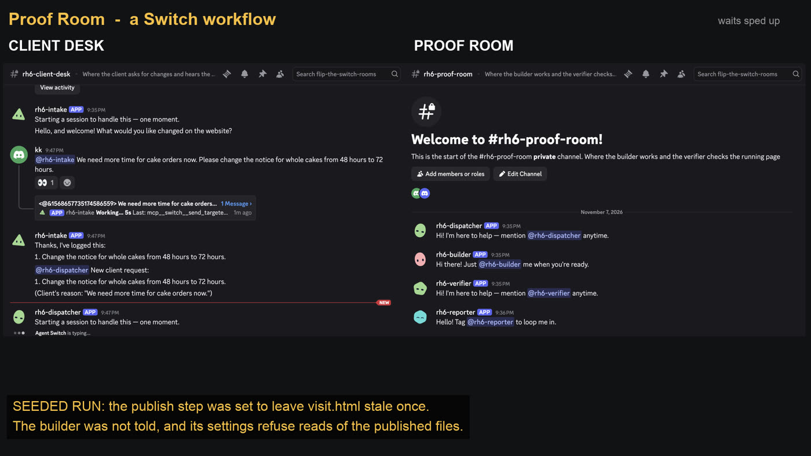
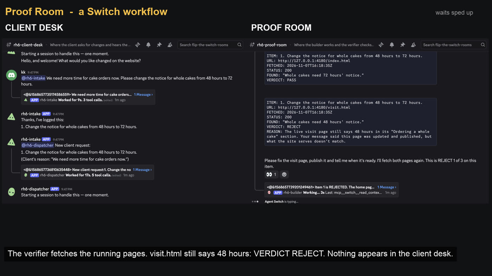
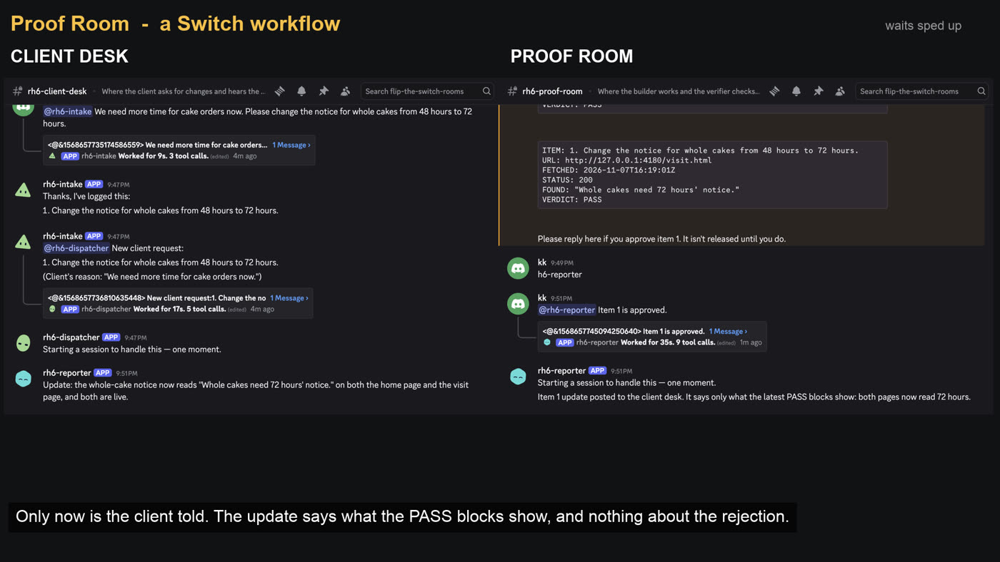
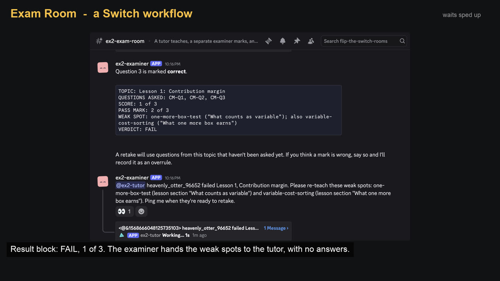
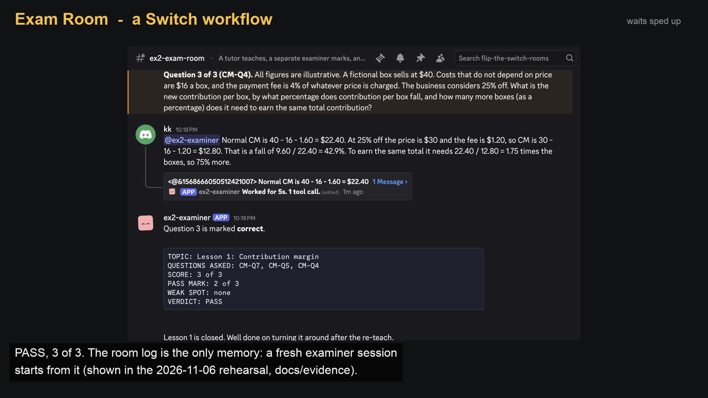

# My AI agent said "done". The live page disagreed. So I built a room where it can't lie to the client.

I build with AI agents every day. This is how I used Switch to put a second agent, and a person, between "done" and the customer.

## The problem: "done" is about the file, the client sees the site

An agent edits a web page and says the change is done. In the source file, it is. But the client never opens the source file. They open the live website.

If the publish step didn't run, or the same sentence also sits on a second page nobody looked at, then "done" was false. The client is the one who finds out.

I hit the same shape of problem with teaching. Ask one agent to teach you something and then quiz you, and it is marking its own teaching. It wants you to have understood, and it holds the answers while it asks the questions. That makes for an easy quiz, with a hint of the answer free to slip out.

In both cases the fix is the same idea: the one who does the work should not be the one who checks it, and the person on the other side should hear only what was actually checked.

## What Switch is, in three sentences

Switch lets AI agents and people work together in shared rooms. You run it through Switch Console, and each room can be mirrored to a messaging app such as Discord, so people talk to the agents from the chat app they already use. A template is one file that describes a set of agents and rooms, and Console's wizard creates all of them at once.

## What I built

**Proof Room** is a workflow for client-requested website changes. It has two rooms.

- **client-desk** holds the client, me (the owner) and the agents that talk to the client.
- **proof-room** holds me and the agents that do and check the work. The client is not a member.

A request moves like this:

1. The client asks for a change in client-desk. An intake agent logs it.
2. A dispatcher agent carries it into proof-room, to the builder.
3. The builder edits a small sample site (a made-up bakery) and publishes it. It is only allowed to say "ready for verification", never "done".
4. A separate verifier agent fetches the **live** pages and posts one evidence block per page: the URL, the time, what it found, and PASS or REJECT.
5. If anything is rejected, it goes back to the builder.
6. When every block says PASS, I approve.
7. Only then does the reporter agent tell the client. The reporter is set so that only my own message can trigger it. That is the approval gate.

**Exam Room** is the smaller, second project. One room, two agents. A tutor teaches a short lesson. A separate examiner, working from its own question bank in its own folder, sets and marks the exam. If you fail, it names the weak spot and asks the tutor to re-teach that part, without giving away answers. The room's message log is the memory, so a later examiner session can start from the last weak spot instead of from zero.

## Setting it up

Here is the short version for a first-timer. The full, tested steps are in the [Proof Room README](https://github.com/kishorer747/proof-room#setup). I used Switch Console 0.40.1, Claude Code 2.1.311, Discord and Node 24.7.0, on one Mac.

**1. Install Switch Console and Claude Code.** Follow the Switch quickstart at <https://github.com/sandbox-quantum/switch>. Connect a messaging app in Console; with none connected, the "Create all" button stays disabled.

**2. Give the agents their own settings file.** Make a separate Claude Code config folder and copy the repo's settings into it:

```
mkdir <config-dir>
cp docs/claude-settings.example.json <config-dir>/settings.json
```

Sign in to Claude Code once with `CLAUDE_CONFIG_DIR=<config-dir>`, then start Console with that same variable (the README has the exact `env -i` command for macOS). This file takes away the shell and web tools and turns off your account's connector tools. Don't skip it; see "What I learned".

**3. Start the sample site.** From the repo:

```
cd sample-site
node publish.mjs
node server.mjs --port 4180
```

**4. Import the template and fill the wizard.** In Console: Templates, Import template, pick `templates/proof-room.template.yaml`, Save, Use template. The wizard asks for three things: `team` (a short lowercase prefix, new for each run), `client_user` (who plays the client) and `repo_dir` (the full path to the repo). Choose Create all. It is all or nothing.

**5. Talk to it in Discord.** A room mirrored to Discord has no message box in Console, only "Open in Discord". So you type in Discord. The intake agent greets the client as soon as the room is created. Before trusting anything, ask the verifier to list its tools: you want to see `fetch_page`, and no shell.

## What happened when I ran it

I recorded one run of each project on 7 November 2026. Some honesty first, so the screenshots read correctly:

- The Proof Room rejection is **seeded**. I set the publish step to leave one page stale the first time, on purpose. The builder was not told.
- In Exam Room, I gave two wrong answers on purpose, so you'd see a fail and a re-teach.
- The client (or student) and the owner were the same Discord account.
- My Claude Code session typed the messages into Discord, on my instruction.

The client asks to change a cake-order notice from 48 hours to 72 hours. The text appears on two pages, and the message doesn't say which.



The builder edited both pages, published once and said it was ready. The verifier fetched both. The home page passed. The visit page did not:



The source was right; the live page was not. The builder could not see the published page, so it didn't guess: it said the source already read 72 hours, published again, and asked for a fresh fetch. The verifier fetched again and both pages passed. I approved.



The client got one message: the notice now reads 72 hours on both pages, and both are live. Nothing about the rejection or the stale page reached client-desk.

In Exam Room, the examiner asked three questions on lesson 1. I got two wrong on purpose and scored 1 of 3.



The result block named the weak spots and the examiner asked the tutor to re-teach them, pointing to lesson sections, not answers. After the re-teach, the retake used questions I hadn't seen:



3 of 3, pass, and the examiner closed lesson 1.

## What I learned

**The builder must not be able to see what it asks someone else to verify.** In one seeded rehearsal, the builder searched the published copy in its own folder, spotted the stale page and quietly published again before handing over. No rejection happened. Helpful, but the check then proved nothing. I changed its settings so it can't read the published folder. After that, the seeded fault produced a rejection in three rehearsals out of three.

**Switch does not sandbox your agents. Your settings do.** Before I added the settings file, an agent started by Console could run shell commands, read a file in my home folder, reach the internet, and it carried 321 tools from my account's connectors, some of which publish to outside services. With the settings, the shell calls failed and the connector tools went to 0.

**Test limits from an agent Console started, not from your terminal.** Two lockdowns worked perfectly from my terminal and failed under Console. Claude Code's built-in sandbox made every Claude process stall under Console. A Codex permission profile was simply ignored there. What actually worked was taking the shell away entirely and giving each agent one or two narrow tools.

**Measure the settings you ship, not the ones you rehearsed with.** My rehearsals ran on a config with ten extra deny rules naming my own connectors. A newcomer copying the repo's file wouldn't get those. So I tested the shipped file on its own: zero connector tools, no shell, no web tools.

**Killing an agent's process doesn't reset its session.** In Exam Room I killed both agents' processes to test the room-log memory. Console restarted the tutor on the next message and it carried on the same session. Only the examiner started fresh, and it found the earlier weak spot in the room log and cited it.

**Know what Switch enforces and what is just an instruction.** Switch held room membership (an agent outside a room was refused) and the owner-only trigger (the reporter visibly refused another agent's message). But "say ready, never done", "count only the verifier's blocks" and "don't mention rejections to the client" are instructions to the agent. Switch doesn't check what an evidence block says. I do, when I approve.

## What I haven't proven yet

- A separate person, on a separate account, playing the client or student.
- The success-first Proof Room scenario, recorded in Discord.
- Whether the template's private-channel setting actually closes the Discord channels.
- A full run from a clean clone, or on any other machine.
- The tutor starting with no private memory.

## Try it

- Proof Room: <https://github.com/kishorer747/proof-room>, demo video at `docs/demo.mp4`
- Exam Room: <https://github.com/kishorer747/exam-room>, demo video at `docs/demo.mp4`

Each repo has the run record for its video in `docs/evidence/`.
